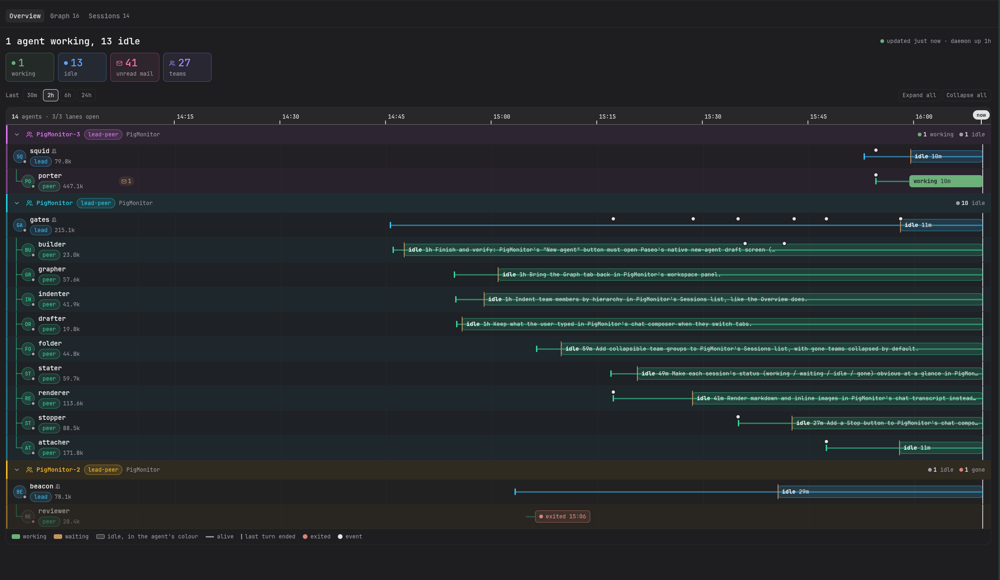
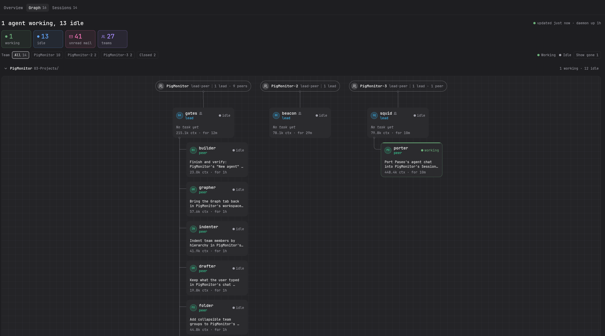
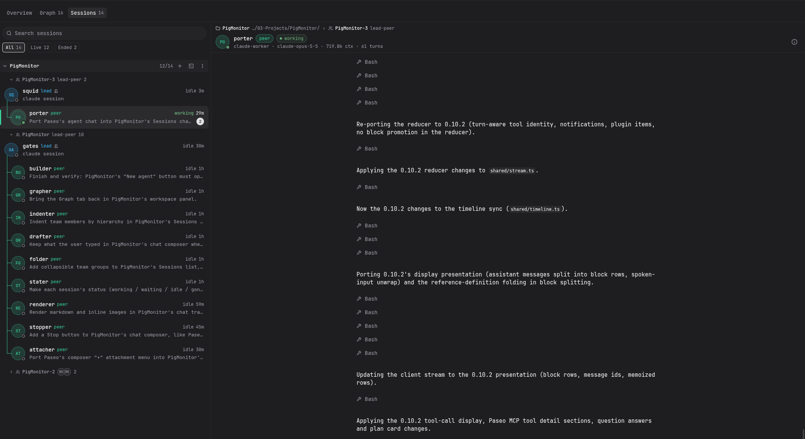

# PigMonitor

A [Paseo](https://github.com/getpaseo/paseo) plugin that shows your piggery agent teams inside Paseo.

https://github.com/user-attachments/assets/29efaaa3-40c8-463a-98e0-a167675429f4

## Install

You need Paseo 0.11.0 or newer, piggery on the Paseo daemon's PATH, and Node 22.5 or newer.

```
paseo plugin install github:Patruxs/PigMonitor
```

Update to the latest commit on main, or add `--ref` with a release tag to move to that release:

```
paseo plugin update pigmonitor
```

Releases and their notes are on the [releases page](https://github.com/Patruxs/PigMonitor/releases).

PigMonitor then appears in Paseo's sidebar and as a workspace panel.

## What you see

- **Overview**: a timeline of every team and agent, coloured by state, with who needs you and unread mail.



- **Graph**: each team as an org chart. Open any agent or team for its details.



- **Sessions**: read an agent's transcript and mail, write to it, stop its turn or resume an ended session.



## Settings

- **piggery binary**: full path to piggery. Empty uses the piggery that installed the plugin, else `piggery` on PATH.
- **piggery database**: the database Sessions reads. Empty means `~/.piggery/piggery.db`.
- **Colours**: the colours of states, roles, mail and teams, as hex or Paseo theme tokens.
- **Avatars**: off (initials), Manual (pick an icon per person) or Auto random (distinct icons within each role, with Reshuffle). When a role has more people than the 18 icons, the latest arrivals keep their initials.

## Development

```
git clone https://github.com/Patruxs/PigMonitor.git
paseo plugin install ./PigMonitor
paseo plugin reload pigmonitor
npm install
npm run check
```

Reload after each change. Notes: [docs/piggery-view.md](docs/piggery-view.md) and [docs/ui.md](docs/ui.md).

## License

MIT
